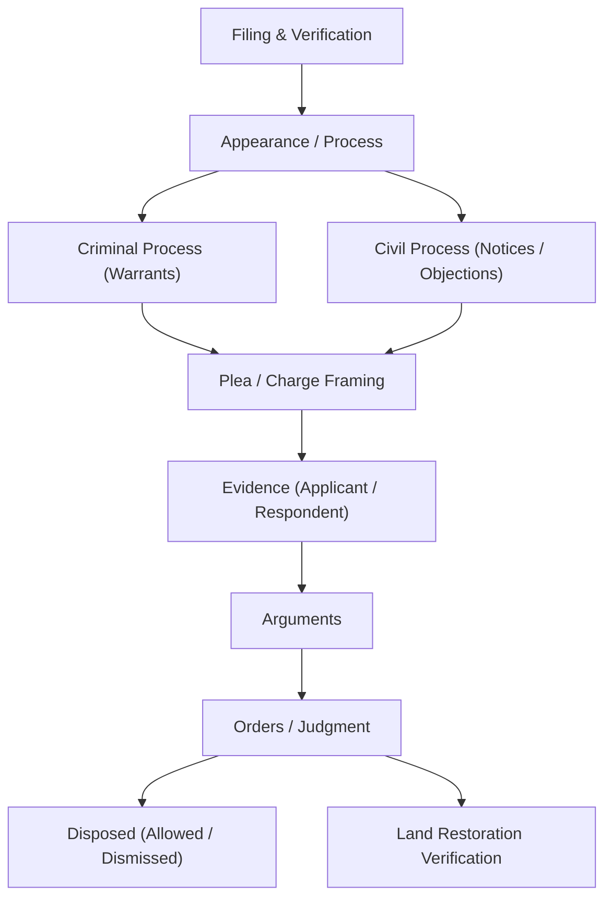
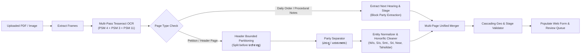

# Karnataka Land Grabbing Prohibition Special Courts — Case & Cause List Register

A full-stack case registry, cause list manager, and document OCR automation platform built specifically for the **Karnataka Land Grabbing Prohibition Special Courts (Bengaluru)**.

This system digitizes court order sheets, petitions, and proceedings, automatically extracting case details, separating party names from addresses, mapping legal stages, and providing an integrated side-by-side continuous PDF document viewer.

---

## Table of Contents
1. [Key Features](#key-features)
2. [Application Architecture](#application-architecture)
3. [Master Prompt: Recreate or Build the Website](#master-prompt-recreate-or-build-the-website)
4. [Data Model & Legal Procedural Hierarchy](#data-model--legal-procedural-hierarchy)
5. [OCR & Intelligent Extraction Pipeline](#ocr--intelligent-extraction-pipeline)
6. [Local Installation & Setup](#local-installation--setup)
7. [Cloud Deployment (Render / Docker)](#cloud-deployment-render--docker)
8. [License](#license)

---

## Key Features

- **Dual Registry Operating Modes**:
  - **Pending Cases Mode** (Deep Maroon Theme `#7a2021`): Manage ongoing matters, future hearing dates, stage groups, procedural sub-stages, summons, warrants, and encroached land extents.
  - **Disposed Cases Mode** (Olive/Green Theme): Record disposal nature (*Allowed, Dismissed, Disposed, Convicted, Acquitted*), final judgment date, and land restoration status.
- **Intelligent Side-by-Side PDF Viewer**:
  - Live split-view: Data entry form on the left, PDF document on the right.
  - **Continuous Scrollable Pages**: All pages of a multi-page PDF render in a single, smoothly scrollable vertical feed.
  - Zoom controls (`Fit`, `+`, `-`), page jump, and local PDF folder browsing.
- **Precision OCR Extraction Engine**:
  - Multi-pass Tesseract OCR:
    - **PSM 4**: Single-column layout pass (prevents margin notes from creating scrambled columns).
    - **PSM 3**: Standard block pass.
    - **PSM 11**: Sparse pass for handwritten margin dates, court hall stamps, and adjournment notes.
  - Optional Ollama Vision LLM integration for complex multi-modal analysis.
- **Clean Party Separation**:
  - **Applicant Name(s)** and **Applicant Address** are cleanly separated into distinct fields.
  - **Respondent Name(s)** and **Respondent Address** are cleanly separated.
  - Handles multi-respondent numbered lists (`1. Name`, `2. Name`...) with shared common addresses (e.g., `4 to 7. Lokapura, Mudhol Taluk. Bagalkote District`).
  - Standardizes Kannada honorifics (`ಶ್ರೀಮತಿ` $\rightarrow$ `Smt.`, `ಶ್ರೀ` $\rightarrow$ `Sri`, `ಕೋಂ` $\rightarrow$ `W/o`, `ಬಿನ್` $\rightarrow$ `S/o`, `ಹತ್ತಿರ` $\rightarrow$ `Near`, `ತಹಶೀಲ್ದಾರರು` $\rightarrow$ `Tahsildar`).
  - **Procedural Order Sheet Isolation**: Judge's order paragraphs (*"Adeshada Prati"*, encroached land descriptions, adjournment proceedings like *"Respondent called out, absent..."*) are strictly prevented from polluting party fields.
- **Complete Karnataka Administrative Geography**:
  - 4-Tier cascading dropdowns: **District $\rightarrow$ Taluk $\rightarrow$ Hobli $\rightarrow$ Village** across all 31 Karnataka revenue districts.
- **Legal Stage & Stage Group Hierarchy**:
  - 20 Karnataka Court Stage Groups (*Appearance, Criminal Process, Civil Process, Evidence, Plea / Charge, Arguments, Orders, Reports / Verification, etc.*).
  - Bidirectional sync: Choosing a stage group filters sub-stages; picking a sub-stage auto-selects its parent group.
- **Batch Processing & Review Queue**:
  - Upload multiple PDFs/images simultaneously.
  - Batch dashboard with progress meter, OCR review queue, `Populate Form`, and `Save & Next`.
- **Export & Synchronization**:
  - Instant CSV & JSON exports formatted for court cause lists and registrar registers.
  - Instant live filter & search by case number, party name, village, or hearing date.

---

## Application Architecture

```
├── case.py                   # Core business logic, OCR normalizer, and desktop Tkinter client
├── server.py                 # Lightweight Python HTTP backend & REST API (/api/scan, /api/status, etc.)
├── generate_final_index.py   # Compiles Karnataka geographies, stages, and UI into index.html
├── index.html                # High-performance responsive single-page web application
├── render.yaml               # Infrastructure-as-code specification for Render cloud deployment
└── cases.db                  # SQLite database for persistent storage (shared with localStorage)
```

---

## Master Prompt: Recreate or Build the Website

Use the prompt below with any AI coding assistant (such as Antigravity, Claude, or ChatGPT) to regenerate or build this full application from scratch:

```markdown
You are a senior full-stack legal tech software engineer. Build a complete, production-ready web application: "Karnataka Land Grabbing Prohibition Special Courts — Case & Cause List Register".

### 1. APPLICATION PURPOSE & SCOPE
The application is a dual-mode legal case registry and cause list manager designed for Karnataka Special Courts. It enables data entry operators and court clerks to review scanned case petitions, order sheets, and daily proceedings side-by-side with an auto-populating form powered by OCR.

### 2. THEMES & DUAL OPERATING MODES
- **Pending Cases Mode**: Deep maroon / burgundy theme (`#7a2021` header/accents, warm parchment `#fcfbf8` background, `#2b303a` sidebar). Focuses on upcoming hearings, procedural stages, summons/warrants, and land extents.
- **Disposed Cases Mode**: Olive / dark green theme. Focuses on final disposal nature (Allowed, Dismissed, Disposed, Convicted, Acquitted), disposal date, and land restoration status (Yes, No, Partial).
- A prominent toggle button in the top navigation bar must seamlessly switch between Pending and Disposed modes, dynamically updating form fields and visible statistics.

### 3. LAYOUT & USER INTERFACE
- **Header**: Displays court emblem/logo, active database counter, action buttons (Export CSV, Export JSON, Scan Images, Batch Process, Compare PDF, Set PDF Folder), and the Disposed Mode switch.
- **Navigation Sidebar (Left)**: Collapsible sidebar with shortcuts:
  - 01 Case Navigator (list and filter existing cases by date or search term)
  - 02 Pending Cases Entry (active data entry form)
  - 03 Disposed Cases Entry
  - 04 Export & Backup
- **Main Workspace (Split View)**:
  - **Left Pane (50% default width)**: Case Data Entry Form.
  - **Right Pane (50% default width)**: Integrated PDF / Image Document Viewer.
  - Must include a draggable vertical divider or responsive split that adapts to mobile viewports.
- **Continuous Scrollable PDF Viewer**:
  - When a multi-page PDF is loaded, render ALL pages in a single, vertically scrollable container.
  - Page header displays: filename, active page / total pages indicator, zoom buttons (`Fit`, `+`, `-`), page navigation arrows, and external PDF folder selector.
  - Smooth wheel scrolling from Page 1 to Page N without needing manual pagination buttons.

### 4. DATA ENTRY FORM FIELDS & BUSINESS LOGIC
1. **Case Details**:
   - **Court Hall**: Dropdown with options: `Court Hall No.1`, `Court Hall No.2`. If the filename starts with `CH1` or `Court hall 1`, default to Court Hall No.1; if `CH2`, default to Court Hall No.2.
   - **Case Type**: Dropdown with values: `L.G.C. (G)` (General), `L.G.C. (P)` (Private), `L.G.C. (T)` (Transferred), `L.G.C. (S)` (Special), `RP` (Review Petition), `Misc`.
   - **Case Number**: **Numeric case number ONLY** (e.g., `2084`, `1382`). Do NOT include court prefixes or years in this field.
   - **Filing Year**: 4-digit year dropdown/number input (default: `2024` or current year).
   - **CNR Number (Optional)**: 16-character alphanumeric field (e.g. `KABG010012342024`).
2. **Parties (Separate Names & Addresses in English)**:
   - **Applicant Name(s)**: Multi-line text area. Contains only the name/designation (e.g. `Tahsildar` or `Kamala El. W/o Suresh`).
   - **Applicant Address**: Multi-line text area. Contains only the applicant's address (e.g. `Mudhol Taluk, Bagalkote District`).
   - **Respondent Name(s)**: Multi-line text area. Contains numbered respondent names (e.g. `1. Smt. Mathurabayi W/o Vithala Limakara\n2. Smt. Surekha W/o Namadeva Maladakara`).
   - **Respondent Address**: Multi-line text area. Contains corresponding addresses. Supports grouped addresses (e.g. `4 to 7. Lokapura, Mudhol Taluk. Bagalkote District`).
   - **Isolation Rule**: Judge's order text (*"Adeshada Prati"*, extent paragraphs) and daily order proceedings (*"Respondent called out, absent..."*) must NEVER leak into party fields.
3. **Case Status & Procedural Stages**:
   - **Stage Group**: Dropdown with 20 standard groups (*Appearance, Criminal Process, Civil Process, Evidence, Arguments, Orders, Reports / Verification, etc.*).
   - **Current Stage / Sub-Stage**: Dropdown with standard legal steps (*Summons to Accused, Bailable Warrant, Non-Bailable Warrant, Sworn Statement, Summons to Witness, Await Report, For Orders, Hearing, etc.*).
   - Dropdowns must be bidirectionally synced: selecting a group filters sub-stages; selecting a sub-stage auto-selects its parent group.
4. **Dates**:
   - **Next Hearing Date**: Date picker (Pending mode).
   - **Disposal Date**: Date picker (Disposed mode).
   - **Restoration of Land**: Dropdown (`No`, `Yes`, `Partial`, or `N/A`).
5. **Land Extent & Property Identifiers**:
   - **Extent Value**: Numeric/decimal string (e.g. `35`, `04.05`, `253`).
   - **Extent Unit**: Dropdown (`Acre`, `Acre + Guntas`, `Guntas`, `Square feet`, `Cent`).
   - **Survey No. (Sy. No.)**: Alphanumeric input (e.g. `145`, `73/1`).
   - **Ward No.**, **PID No.**, **Property Tax Assessment No.**: Optional text fields.
6. **Property Location (Karnataka Revenue Geography)**:
   - Cascading dropdowns: **District** $\rightarrow$ **Taluk** $\rightarrow$ **Hobli** $\rightarrow$ **Village**.
   - Pre-populate all 31 districts of Karnataka and their standard taluks/hoblis.

### 5. BACKEND & OCR EXTRACTION PIPELINE
- **Language & Server**: Python 3 standard library `http.server` (no heavyweight dependencies required).
- **OCR Engine**: Tesseract OCR via subprocess:
  - Language: `kan+eng`.
  - Passes: Run PSM 4 (single column) first to preserve document hierarchy, followed by PSM 3 and PSM 11 (sparse text for handwritten notes and margin stamps).
- **Extraction Rules**:
  - Strictly bound party searches to text preceding the `ಆದೇಶ ಪತ್ರ` / `Order Sheet` header.
  - Automatically reject daily order / adjournment sheets (*"called out, absent"*, *"taken up on board"*) from party extraction.
  - Distinguish encroached land area from total survey land area in judge order sheets.
  - Support multi-page merging: aggregate pages belonging to the same case file into a unified case record.
- **REST API Endpoints**:
  - `POST /api/scan`: Accepts multipart file uploads (PDF/images), runs extraction, and returns JSON case records.
  - `GET /api/status`: Checks availability of Tesseract and Ollama.
  - `GET /api/pdf-folder`: Lists files from the selected local court folder.
  - `GET /api/render-page`: Renders a specific PDF page as PNG or returns raw bytes.

### 6. CLIENT STORAGE & OFFLINE PERSISTENCE
- Store cases in dual storage: `localStorage` on the client and SQLite on the backend.
- Provide instant one-click CSV and JSON exports with complete headers:
  `["Sl.", "Case No.", "Type", "Court Hall", "Applicant Name", "Applicant Address", "Respondent Name", "Respondent Address", "Filing Year", "Status", "Next Hearing / Dispose Date", "Current Stage", "Stage Group", "Extent", "Unit", "Survey No", "Village", "Taluk", "District"]`
- Provide full import and backup restore capabilities.
```

---

## Data Model & Legal Procedural Hierarchy

### 1. Case Record Schema

```typescript
interface CourtCase {
  id: string;                     // Unique record UUID
  caseNo: string;                 // Numeric case number ONLY (e.g. "2084")
  fullCaseNo: string;             // Formal title (e.g. "L.G.C.(P).No.2084/2024")
  type: "G" | "P" | "T" | "S" | "RP" | "Misc";
  case_type: string;              // Normalized format: "LGC(G)", "LGC(P)", etc.
  court: "Court Hall No.1" | "Court Hall No.2";
  filedYear: number;              // 4-digit filing year (e.g. 2024)
  cnr?: string;                   // 16-character eCourts CNR number

  // Parties
  applicant_name: string;         // Plain names/designations (e.g. "Tahsildar")
  applicant_address: string;      // Geographic address (e.g. "Mudhol Taluk, Bagalkote District")
  respondent_name: string;        // Numbered list of respondent names
  respondent_address: string;     // Numbered or grouped list of addresses

  // Legal Status
  status: "Pending" | "Disposed";
  stageGroup: string;             // e.g. "Evidence", "Orders", "Criminal Process"
  currentStage: string;           // e.g. "Summons to Witness", "Bailable Warrant"
  nextHearing?: string;           // YYYY-MM-DD
  disposedDate?: string;          // YYYY-MM-DD
  disposalNature?: "Allowed" | "Dismissed" | "Disposed" | "Convicted" | "Acquitted";
  restorationOfLand: "Yes" | "No" | "Partial" | "N/A";

  // Land & Property
  landExtent: string;             // Extent numeric string (e.g. "253", "04.05")
  extentUnit: "Acre" | "Acre + Guntas" | "Guntas" | "Square feet" | "Cent";
  surveyNo: string;               // Survey number / Sub-division
  wardNo?: string;
  pidNo?: string;
  propertyTaxAssessmentNo?: string;

  // Geography
  district: string;               // e.g. "Bagalkote"
  taluk: string;                  // e.g. "Mudhol"
  hobli: string;                  // e.g. "Lokapur"
  village: string;                // e.g. "Lokapur"
  notes?: string;
  createdAt: string;
}
```

### 2. Stage Groups & Procedural Steps



---

## OCR & Intelligent Extraction Pipeline

The extraction architecture uses a multi-stage funnel designed specifically for Indian court documents:



---

## Local Installation & Setup

### Prerequisites
- **Python**: Version 3.10 or higher.
- **Tesseract OCR**:
  - **macOS**: `brew install tesseract tesseract-lang`
  - **Ubuntu / Debian**: `sudo apt-get install -y tesseract-ocr tesseract-ocr-kan tesseract-ocr-eng`
  - **Windows**: Install via official installer and add to system `PATH`.
- **Node.js** (Optional): Used only for checking JavaScript syntax.

### Running the Application

1. **Clone the Repository**:
   ```bash
   git clone https://github.com/seamykiin/special-courts-case-manager.git
   cd special-courts-case-manager
   ```

2. **Start the Web Server**:
   ```bash
   python3 server.py
   ```
   *Output:*
   ```text
   Special Courts Server running at http://localhost:8000
   Open http://localhost:8000 in your browser.
   ```

3. **Re-generating `index.html` (Optional)**:
   If you modify stage dictionaries, Karnataka geographies, or layout components in `generate_final_index.py`:
   ```bash
   python3 generate_final_index.py
   ```

---

## Cloud Deployment (Render / Docker)

The repository includes a ready-to-use [`render.yaml`](file:///Users/jalaj/Documents/Case/render.yaml) blueprint for one-click deployment on Render.

### Render Configuration (`render.yaml`)
```yaml
services:
  - type: web
    name: special-courts-case-manager
    runtime: python
    buildCommand: apt-get update && apt-get install -y tesseract-ocr tesseract-ocr-kan tesseract-ocr-eng && pip install -r requirements.txt || true
    startCommand: python3 server.py --host 0.0.0.0 --port $PORT
    envVars:
      - key: PYTHON_VERSION
        value: 3.11.0
```

### Dockerfile (Optional standalone container)
```dockerfile
FROM python:3.11-slim

RUN apt-get update && apt-get install -y \
    tesseract-ocr \
    tesseract-ocr-kan \
    tesseract-ocr-eng \
    && rm -rf /var/lib/apt/lists/*

WORKDIR /app
COPY . /app

EXPOSE 8000
CMD ["python3", "server.py", "--host", "0.0.0.0", "--port", "8000"]
```

---

## License

Developed for the **Karnataka Land Grabbing Prohibition Special Courts Register & Cause List System**. All rights reserved. Distributed under the MIT License.
